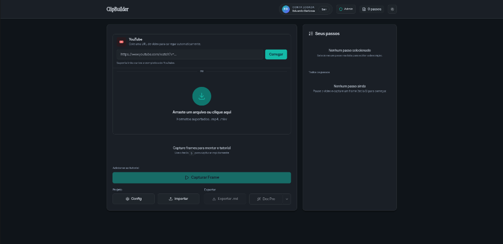
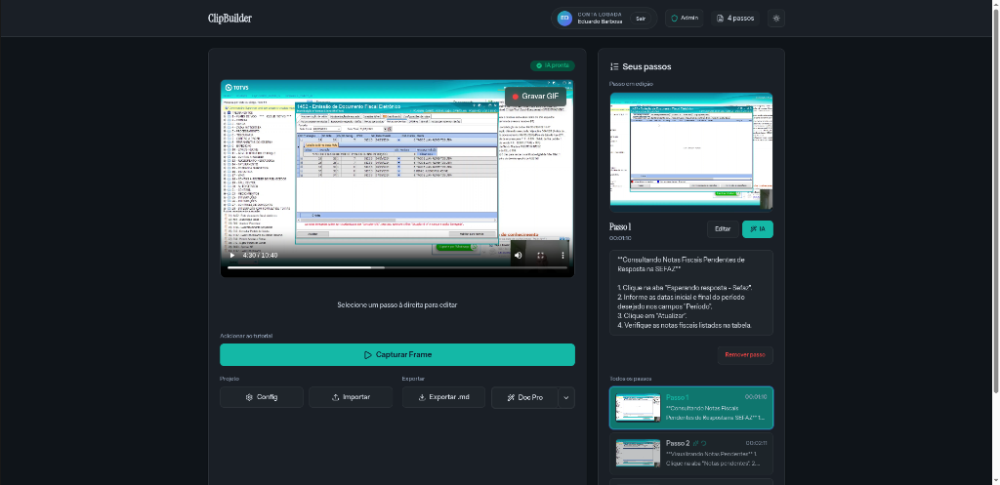
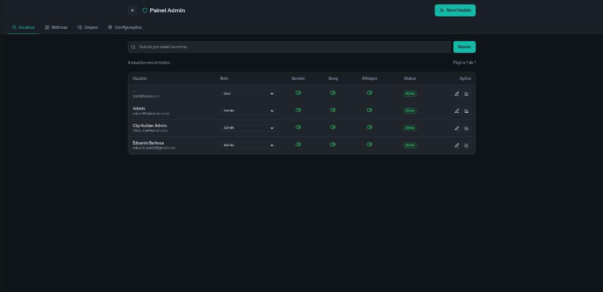
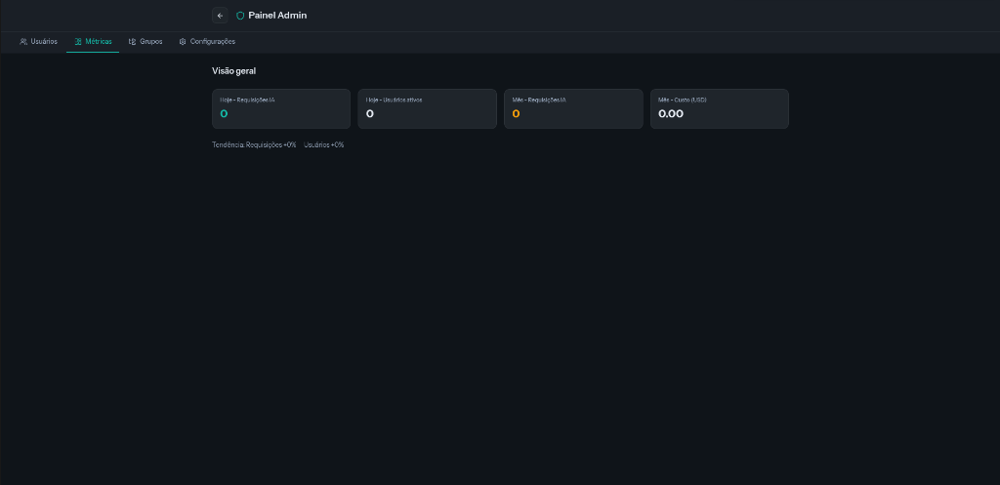
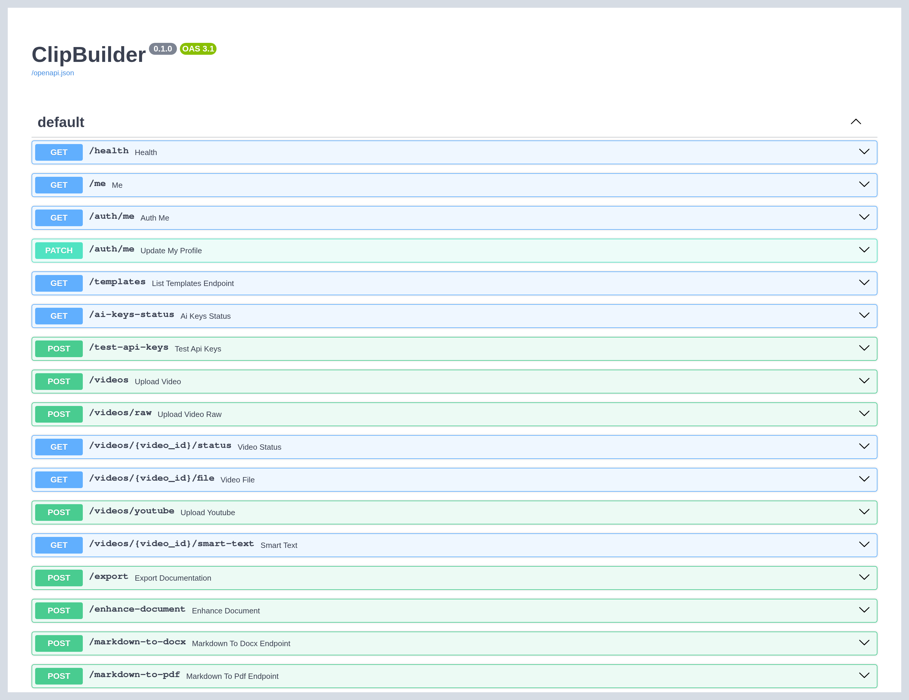
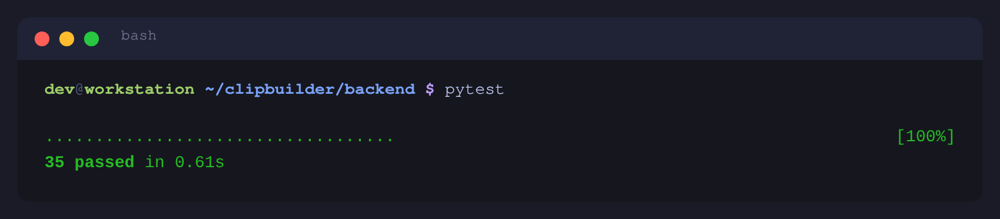

<div align="center">

# 🎬 ClipBuilder

### Turn a screen recording into a finished, illustrated step-by-step guide — with AI

[](https://python.org)
[](https://fastapi.tiangolo.com)
[](https://react.dev)
[](https://postgresql.org)
[](https://docker.com)
[](LICENSE)

</div>

---

**Writing software documentation means recording yourself doing the task, then screenshotting every step, cropping each image, drawing the arrows, and typing the instructions. It takes an afternoon per guide.**

ClipBuilder does it from the video. Upload a recording (or paste a YouTube link), and the AI watches it, transcribes the audio, picks the meaningful frames and writes the step-by-step text. You review, annotate and export to Word, PDF, HTML or Markdown.

It is a complete SaaS: multi-tenant authentication, an admin panel with per-user AI quotas, usage metering and subscription billing.

---

## What it does

### 📥 Flexible input
- Direct upload (MP4, MKV) with drag & drop
- YouTube import via `yt-dlp`

### 🤖 Three AI models, each for what it is best at
- **Gemini** — native video analysis, reasoning over timestamps rather than isolated frames
- **Llama 4 Vision** — frame and GIF analysis
- **Whisper Large v3 Turbo** — audio transcription
- Step descriptions are generated automatically from all three signals

### 🎨 In-browser visual editor
- Arrows, text and rectangles over any frame (Fabric.js)
- Crop and adjust without leaving the page
- Animated GIF steps captured straight from the video, described by the AI

### 📄 Professional export
- **DOCX** — a structured Word document assembled by AI
- **PDF** — print-ready
- **HTML** — one standalone page
- **Markdown** — with a ZIP of the images
- **Plain text**

### 🛡️ Admin panel
- Users, roles and permissions through Clerk, with social login
- Groups and departments
- Per-user AI quotas, so one person cannot burn the whole budget
- Usage and cost dashboard
- System settings (SMTP, storage, API keys) editable from the UI

### 💳 Billing
- Subscription plans with Mercado Pago, webhook-driven

---

## Architecture

```
┌─────────────────────────────────────────────────────────────┐
│               FRONTEND (React 18 + Vite)                    │
│              port 80 (prod) / 5173 (dev)                    │
└─────────────────────────┬───────────────────────────────────┘
                          │  /api (Nginx reverse proxy)
┌─────────────────────────▼───────────────────────────────────┐
│               BACKEND (FastAPI + Uvicorn)                   │
│                        port 8000                            │
│   ┌──────────┐   ┌──────────┐   ┌──────────┐   ┌─────────┐  │
│   │  Gemini  │   │ Llama 4  │   │ Whisper  │   │ FFmpeg  │  │
│   │  video   │   │  vision  │   │  audio   │   │ frames  │  │
│   └──────────┘   └──────────┘   └──────────┘   └─────────┘  │
└─────────────┬───────────────────────────────┬───────────────┘
              │                               │
┌─────────────▼──────────────┐  ┌─────────────▼──────────────┐
│  PostgreSQL 16             │  │  Clerk                     │
│  SQLAlchemy 2 + Alembic    │  │  social login, roles,      │
│  port 5432                 │  │  sync webhooks             │
└────────────────────────────┘  └────────────────────────────┘
```

---

## Tech stack

| Layer | Technologies |
|---|---|
| **Frontend** | React 18, Vite, TailwindCSS, Fabric.js, React Router, Axios |
| **Backend** | Python 3.12, FastAPI, SQLAlchemy 2, Alembic, Pydantic, Uvicorn |
| **AI** | Google Gemini, Llama 4 Scout (vision), Whisper Large v3 Turbo, PydanticAI |
| **Media** | FFmpeg, yt-dlp |
| **Data & auth** | PostgreSQL 16, Clerk |
| **Export** | python-docx, ReportLab, standalone HTML, Markdown |
| **Payments** | Mercado Pago |
| **Infrastructure** | Docker Compose, Nginx, Let's Encrypt |

---

## Installation

### Requirements

- Docker and Docker Compose
- A [Gemini API key](https://aistudio.google.com/apikey)
- A [Clerk](https://clerk.com) application (free tier is enough)

### Run it

```bash
git clone https://github.com/<your-user>/clipbuilder.git
cd clipbuilder

cp .env.example .env && chmod 600 .env
# fill in DB_PASSWORD, SECRET_KEY, ADMIN_PASSWORD, CLERK_* and GEMINI_API_KEY
# generate secrets with: openssl rand -hex 32

docker compose up -d --build
```

- Frontend: <http://localhost:5173>
- API docs: <http://localhost:8000/docs>

Every setting lives in `.env` — see that file for the annotated list.

### Running the backend locally

```bash
cd backend
python -m venv .venv && source .venv/bin/activate
pip install -r requirements.txt
uvicorn main:app --reload
```

Tests:

```bash
cd backend && pytest
```

---

## How it is used

1. **Sign in** — social login or e-mail through Clerk.
2. **Import a video** — upload a file or paste a YouTube URL.
3. **Capture frames** — pick them by hand on the timeline, or let the AI choose the meaningful moments.
4. **Generate the steps** — the AI watches the video, reads the transcript and writes a description per step.
5. **Annotate** — arrows, highlights and text, right in the browser.
6. **Export** — DOCX, PDF, HTML or Markdown.

---

## Notes

- The application UI ships in Portuguese (pt-BR); the AI output language is configurable through `CLIPBUILDER_AI_LANGUAGE`.
- No credential is committed: `.env`, `cloudflare.ini` and YouTube cookies are all gitignored, with `.example` files in their place.

---

## Screenshots

| | |
|---|---|
|  |  |
| **Dashboard** — projects and their status | **Editor** — frames, annotations, step text |
|  |  |
| **Admin — users** — roles, groups, AI quotas | **Admin — metrics** — usage and cost per model |

### The API



FastAPI's interactive docs at `/docs`: video ingestion, YouTube import, AI enhancement and every export format, all documented.

### Tests



> Still to capture, with the stack running:
>
> - [ ] **`export-docx.png`** — a generated Word document open in Word, showing the numbered steps with their screenshots. This is what the user is actually buying.
> - [ ] **`ai-generating.png`** — step generation in progress.
> - [ ] **`gif-step.png`** — an animated GIF step with its AI-written description.

---

## License

MIT — see [LICENSE](LICENSE).
