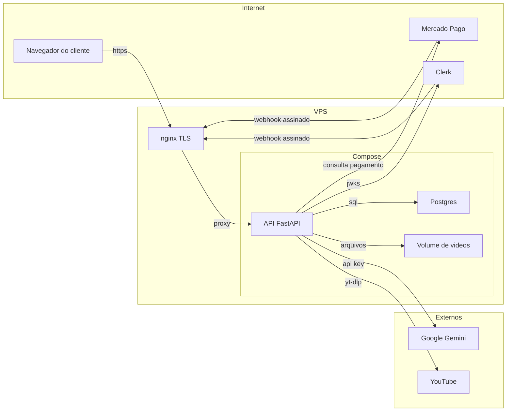

# Modelo de ameaças do ClipBuilder

Versão de 20/11/2026, sobre a branch `fase-1-seguranca`. Método: skill
`security-threat-model` (fluxos de dados, fronteiras de confiança e caminhos de
abuso priorizados por probabilidade e impacto). Cada afirmação sobre a
arquitetura aponta para o código.

## Executive summary

O ClipBuilder é um SaaS multiusuário exposto à internet que paga, com a chave
do servidor, cada chamada ao Gemini feita por um cliente. Os riscos que mais
pesam são, portanto, três: consumir IA ou créditos sem pagar, acessar o
conteúdo de outro cliente (gravações de tela costumam mostrar dados pessoais e
sistemas internos) e derrubar o serviço, que roda num único worker com estado
em memória. Na versão atual, todas as rotas de IA, vídeo e exportação exigem
usuário autenticado e cobram depois de validar; o saldo e a idempotência das
compras são garantidos pelo banco; vídeos têm dono e são servidos por URL
assinada; webhooks recusam eventos sem assinatura. O risco residual mais alto
está na coleta de dados de cartão em campos próprios (aguarda decisão), na CSP
ainda em modo de relatório e na falta de cota de armazenamento por usuário.

## Scope and assumptions

**Em escopo:** `backend/` (API FastAPI, serviços, templates de exportação),
`frontend/src` e a configuração do nginx em `frontend/`, `docker-compose*.yml`,
Dockerfiles e `.github/workflows/`.

**Fora de escopo:** `backend/scripts/` (ferramentas de operação executadas pelo
operador no servidor), testes, a infraestrutura do Clerk, do Mercado Pago e do
Google, e a segurança do sistema operacional da VPS.

**Premissas:**
- O serviço é público na internet, atrás do nginx com TLS (`frontend/nginx.conf`).
- Contas novas do Clerk entram inativas e dependem de aprovação do admin
  (`CLERK_AUTO_PROVISION_USERS=false`; `crud.create_user` cria `is_active` só para admin).
- Um único worker uvicorn; o estado de processamento dos vídeos fica em memória
  (`backend/Dockerfile`, `main._videos`).
- O Postgres não é alcançável de fora da rede do Compose (`docker-compose.yml`, sem `ports`).
- Gravações enviadas pelos clientes podem conter dados pessoais e telas de
  sistemas internos; trechos delas são enviados ao Google (Gemini).

**Perguntas em aberto que mudam a priorização:**
1. Modelo de venda (decisão D1 do plano): operado como SaaS por um único dono,
   ou instalado pelo comprador para os próprios usuários? No segundo caso, o
   risco entre clientes cai e o de configuração insegura pelo comprador sobe.
2. O domínio passa por proxy do Cloudflare? Se sim, o IP visto pelo nginx é o
   da Cloudflare, e o rate limit por IP precisa do módulo `real_ip`.
3. Pagamento com cartão continua em campos próprios ou vai para o Card Payment
   Brick (decisão D4)? Isso define o escopo PCI.

## System model

### Primary components

- **SPA React** (`frontend/src`): login via Clerk (`utils/AuthContext.jsx`),
  editor de frames, cache de trabalho no IndexedDB (`utils/sessionCache.js`).
- **nginx** (`frontend/nginx.conf`, `nginx-app.conf`, `nginx-proxy.conf`): TLS,
  arquivos estáticos, proxy de `/api`, limites de corpo por rota, headers de
  segurança (`security-headers.conf`).
- **API FastAPI** (`backend/main.py`, `backend/app/`): autenticação
  (`app/auth/deps.py`), créditos (`app/billing/service.py`), vídeo
  (`app/services/video_store.py`), exportação (`app/services/export_from_markdown.py`,
  `templates/corporate_docx.py`), tools de IA (`app/tools/`), admin (`app/admin/`).
- **Postgres**: usuários e permissões, livro de créditos, posse de vídeos,
  configurações (senha SMTP cifrada), logs de tools e de uso.
- **Volume de dados** (`CLIPBUILDER_DATA_DIR`): vídeos, partes de upload, clipes temporários.
- **Processos externos no container**: ffmpeg, LibreOffice, yt-dlp com plugins
  de PO Token (`backend/Dockerfile`).
- **Serviços externos**: Clerk (JWT RS256 e webhooks svix), Mercado Pago (API e
  webhooks HMAC), Google Gemini, YouTube, servidor SMTP.
- **CI/CD**: GitHub Actions (`ci.yml`, `deploy.yml`), deploy por SSH na VPS.

### Data flows and trust boundaries

- **Navegador -> nginx**: HTTPS. Dados: JWT do Clerk, vídeos (até 6 GiB em
  `/api/videos` e `/api/videos/raw`), JSON e imagens em base64 (até 128 MB nas
  demais rotas). Garantias: TLS 1.2+, HSTS, nosniff, frame-ancestors; CSP em
  Report-Only.
- **nginx -> API**: HTTP na rede do Compose. O nginx sobrescreve
  `X-Forwarded-For` com o IP da conexão, e o uvicorn confia nesse header
  (`--forwarded-allow-ips`). A API não é publicada para fora.
- **API -> Clerk**: HTTPS. Validação do JWT por JWKS, RS256 fixo, issuer, exp,
  nbf e azp estrito (`app/core/security.py`).
- **Clerk -> API** (`/webhooks/clerk`): assinatura svix obrigatória; só e-mail
  principal verificado vincula contas (`app/auth/webhook.py`, `app/auth/clerk_store.py`).
- **Mercado Pago -> API** (`/billing/webhook`): HMAC-SHA256 obrigatório; o
  handler reconsulta o pagamento na API do MP e credita uma vez por pagamento
  (índice `uq_credit_transactions_purchase_payment`).
- **API -> Gemini**: HTTPS com a chave do servidor. Dados: clipes do vídeo,
  GIFs, texto dos passos. A saída da IA volta ao usuário e às exportações.
- **API -> YouTube** (yt-dlp): só o extrator `youtube`, URL separada por `--`,
  limite de concorrência; opcionalmente via proxy residencial.
- **API -> Postgres**: SQLAlchemy com parâmetros vinculados.
- **API -> disco / ffmpeg / LibreOffice**: arquivos nomeados por UUID gerado no
  servidor; subprocessos com lista de argumentos, sem shell.
- **GitHub Actions -> VPS**: SSH com chave e verificação do host por
  fingerprint; actions presas por SHA; token com `contents: read`.

#### Diagram

## Assets and security objectives

| Asset | Why it matters | Security objective (C/I/A) |
|---|---|---|
| Chave e orçamento do Gemini | Cada chamada é paga pelo dono do serviço | C, A |
| Livro de créditos (`credit_accounts`, `credit_transactions`) | É dinheiro: saldo e compras | I |
| Gravações e capturas dos clientes | Dados pessoais e telas de sistemas internos (LGPD) | C |
| Contas e papel de admin | Admin aprova usuários, altera créditos e configurações | I, C |
| Segredos (`SECRET_KEY`, `LOCAL_JWT_SECRET`, chaves Clerk/MP, senha SMTP) | Assinam URLs, tokens locais e cifram a senha SMTP | C |
| Disponibilidade da API | Um único worker atende todos os usuários | A |
| Pipeline de deploy (chave SSH, workflows) | Controla o código que vai para produção | I |

## Attacker model

### Capabilities

- Visitante anônimo na internet: chama qualquer rota pública, envia corpos
  grandes e tenta forjar webhooks.
- Cliente aprovado mal-intencionado: tem token válido e créditos; tenta usar
  IA de graça, acessar conteúdo de outros e esgotar recursos.
- Autor de conteúdo hostil: controla o vídeo ou o link do YouTube, e por isso
  influencia a saída da IA (injeção de prompt e HTML).
- Atacante de cadeia de suprimentos: publica versão maliciosa de dependência
  ou de action.

### Non-capabilities

- Não alcança o Postgres nem a API sem passar pelo nginx.
- Não forja JWT do Clerk nem webhooks sem os segredos correspondentes.
- Não lê o `.env` nem o volume de dados sem comprometer a VPS.

## Entry points and attack surfaces

| Surface | How reached | Trust boundary | Notes | Evidence (repo path / symbol) |
|---|---|---|---|---|
| Rotas de IA (`/smart-text`, `/describe-gif`, `/enhance-document`, `/generate-documentation`, `/format-and-export`, `/agents/extract-steps`) | HTTPS com JWT | Navegador -> API | Exigem `RequireGemini`; cobram após validar; modelo restrito por allowlist | `main.py` `_debit_user_credits`, `_resolve_model` |
| Upload de vídeo (`/videos`, `/videos/raw`) | HTTPS com JWT, até 6 GiB | Navegador -> API -> disco | Upload em partes preso ao dono, até 4096 partes | `main.py` `upload_video_raw`, `_uploads` |
| Arquivo de vídeo (`/videos/{id}/file`) | URL com token | Navegador -> API | HMAC do `SECRET_KEY` sobre vídeo, dono e expiração (6 h) | `video_store.verify_file_token` |
| Importação do YouTube (`/videos/youtube`) | HTTPS com JWT | API -> YouTube | Extrator restrito, 1 importação por usuário | `main._download_youtube_video` |
| Exportação (`/export`, `/markdown-to-*`) | HTTPS com JWT | Navegador -> API | Imagens só em base64; HTML sanitizado; permissões por formato | `export_from_markdown._sanitize_html`, `_require_export_permission` |
| Webhook do Clerk | HTTPS, assinatura svix | Clerk -> API | Recusa sem secret; e-mail precisa ser verificado | `app/auth/webhook.py` |
| Webhook e checkout do Mercado Pago | HTTPS | MP -> API, Navegador -> API | HMAC obrigatório; crédito idempotente no banco | `app/billing/router.py`, `credit_purchase_once` |
| Login de emergência (`/sys/token`) | HTTPS, e-mail e senha | Navegador -> API | 5/min por IP, resposta única, segredo de 32+ caracteres | `app/auth/local_router.py` |
| Painel admin (`/admin/*`, `/api/tools/*` de escrita) | HTTPS com JWT de admin | Navegador -> API | `RequireAdmin` com papel lido do banco | `app/admin/dependencies.py` |
| Preview do documento (SPA) | Saída da IA renderizada no navegador | IA -> Navegador | DOMPurify sobre o HTML do marked | `EnhancedDocPreview.jsx` |
| Deploy | Push na branch de deploy | GitHub -> VPS | Gate de CI, SSH com fingerprint | `.github/workflows/deploy.yml` |

## Top abuse paths

1. **Gastar o orçamento de IA:** cliente com poucos créditos -> chama as rotas
   de IA em sequência -> cada chamada custa crédito, então o gasto é limitado
   pelo saldo. Admins são isentos de crédito: uma conta de admin comprometida
   gasta sem limite.
2. **Créditos sem pagar:** cliente -> confirma o mesmo pagamento pelo webhook,
   pelo polling e pelo checkout ao mesmo tempo -> o índice único deixa só uma
   confirmação creditar.
3. **Conteúdo de outro cliente:** cliente -> tenta ids de vídeo de terceiros ou
   reutiliza uma URL de arquivo -> 404 para quem não é dono; a URL assinada
   expira em 6 h, mas quem a recebe dentro desse prazo baixa o vídeo.
4. **XSS por injeção de prompt:** autor de vídeo hostil -> faz a IA escrever
   HTML no texto -> o preview e o export HTML sanitizam; um novo ponto de
   renderização sem sanitização reabriria o caminho, e a CSP ainda não bloqueia.
5. **Tomar a conta de admin:** atacante -> cria conta no Clerk com o e-mail do
   admin -> sem verificação do e-mail, nada é vinculado, e o Clerk não promove
   nem reativa contas; só quem controla a caixa de ADMIN_EMAIL entra como admin.
6. **Esgotar o disco:** vários clientes aprovados -> enviam vídeos de 6 GiB até
   o limite de 5 por usuário -> 30 GiB por usuário até a retenção de 24 h agir;
   não há cota de armazenamento por usuário nem por plano.
7. **Travar o worker:** cliente -> dispara exportações em PDF (LibreOffice) e
   uploads em paralelo -> o trabalho pesado roda fora do event loop, mas não há
   rate limit por usuário nessas rotas.
8. **Capturar dados de cartão:** qualquer XSS na página de créditos -> lê
   número e CVV dos campos próprios antes da tokenização.
9. **Cadeia de suprimentos:** dependência ou plugin do yt-dlp comprometido ->
   executa no container da API; o yt-dlp e seus plugins são instalados sem
   versão fixa, e o `--remote-components ejs:github` baixa JavaScript em execução.

## Threat model table

| Threat ID | Threat source | Prerequisites | Threat action | Impact | Impacted assets | Existing controls (evidence) | Gaps | Recommended mitigations | Detection ideas | Likelihood | Impact severity | Priority |
|---|---|---|---|---|---|---|---|---|---|---|---|---|
| TM-001 | Cliente ou atacante com conta de admin | Conta de admin comprometida | Usar IA sem custo de crédito | Gasto direto na conta do Gemini | Orçamento do Gemini | Admin só por papel no banco (`require_admin`) | Admin isento de crédito, sem limite de gasto | Limite diário de chamadas para admin; alerta de gasto no painel do Google | Alerta de custo diário do projeto Google | low | high | medium |
| TM-002 | Cliente | Conta ativa | Confirmar a mesma compra por caminhos concorrentes | Créditos sem pagamento | Livro de créditos | `credit_purchase_once` com `ON CONFLICT` no índice único; saldo por `UPDATE` atômico | Nenhum conhecido | Manter o teste de concorrência no CI | Divergência entre soma das transações e saldo | low | high | low |
| TM-003 | Cliente | Conta ativa e id ou URL de vídeo alheio | Ler vídeo de outro cliente | Vazamento de gravação | Gravações | `video_assets.owner_id`; `_get_owned_entry`; token HMAC com expiração | URL assinada vale 6 h para quem a obtiver; o token aparece no log de acesso do nginx | Reduzir a validade ou ligar o token à sessão; não registrar a query string de `/api/videos/*/file` | 404 em massa em rotas de vídeo por um mesmo usuário | low | high | medium |
| TM-004 | Autor de conteúdo hostil | Influenciar a saída da IA | Injetar HTML ou script no documento | Sessão do usuário, dados de cartão | Contas, cartões | nh3 no export HTML; DOMPurify no preview; escape de nomes e sumário | CSP em Report-Only com `unsafe-inline` | Ativar a CSP após validar Clerk, Turnstile e MP em staging; remover `unsafe-inline` | `report-uri` da CSP | medium | high | high |
| TM-005 | Atacante | Conta no Clerk | Vincular-se a conta existente ou ao admin | Escalada de privilégio | Contas e papel de admin | Assinatura svix obrigatória; só e-mail verificado; não religa conta de outro Clerk; o Clerk não muda papel nem ativa contas; o primeiro admin só nasce num banco sem admin ativo (`app/admin/bootstrap.py`) | Quem controla a caixa de ADMIN_EMAIL entra como esse admin pelo Clerk | Usar em ADMIN_EMAIL um endereço de domínio próprio | Log de mudança de papel | low | high | low |
| TM-006 | Clientes aprovados | Contas ativas | Encher o disco com vídeos grandes | Indisponibilidade para todos | Disponibilidade | Retenção de 24 h e 5 vídeos por usuário; 507 em disco cheio | Sem cota de bytes por usuário ou por plano; `max_video_size_gb` não é aplicado | Cota de armazenamento por plano e alerta de disco | Monitorar uso do volume | medium | medium | medium |
| TM-007 | Cliente | Conta ativa | Saturar o worker com exportações e uploads | Lentidão ou queda | Disponibilidade | Trabalho pesado fora do event loop; `CapacityLimiter` na exportação; limites de corpo no nginx | Sem rate limit por usuário nas rotas caras | Rate limit por usuário (chave = id do usuário) nas rotas de IA e exportação | Latência e fila do worker | medium | medium | medium |
| TM-008 | Atacante com XSS ou extensão maliciosa | XSS na página de créditos | Ler número e CVV antes da tokenização | Fraude e responsabilidade PCI | Cartões | Tokenização no SDK do MP; sanitização do preview | Campos de cartão próprios (PCI SAQ A-EP) | Card Payment Brick em iframe ou só Pix (decisão D4) | Monitoramento de chargebacks | low | high | high |
| TM-009 | Cadeia de suprimentos | Pacote ou componente remoto comprometido | Executar código no container da API | Comprometimento da API e dos segredos | Todos | Locks com hash; pip-audit no CI; actions por SHA; container sem root | yt-dlp e plugins sem versão fixa; JS remoto do `ejs:github`; código da app pertence ao usuário da app | Fixar versões do yt-dlp com atualização periódica; código como root e só leitura (tarefa 4.4) | Alertas de dependências do GitHub | low | high | medium |
| TM-010 | Atacante anônimo | Saber o e-mail do admin | Força bruta no login de emergência | Acesso de admin | Contas | 5 tentativas/min por IP; resposta única; segredo de 32+ caracteres | Força da senha do admin não é verificada | Exigir senha forte ao definir senha local; desligar o login local quando não usado | Log de `local_login: refused` | low | high | low |

## Criticality calibration

- **critical:** acesso sem autenticação a IA paga ou a conteúdo de clientes;
  tomada da conta de admin; crédito gerado sem pagamento. Exemplos: rota de IA
  aceitando requisição anônima; webhook aceito sem assinatura.
- **high:** acesso entre clientes com pré-condição realista; XSS com sessão do
  usuário; exposição de dados de cartão. Exemplos: ler vídeo de outro usuário
  por id; HTML da IA executado no preview.
- **medium:** indisponibilidade causada por um cliente; gasto de IA acima do
  previsto por conta privilegiada; vazamento limitado no tempo. Exemplos:
  encher o disco; URL assinada repassada dentro da validade.
- **low:** vazamento de informação pouco sensível ou ataque que depende de
  condição improvável. Exemplos: descobrir que uma rota existe; replay de
  webhook já idempotente.

## Focus paths for security review

| Path | Why it matters | Related Threat IDs |
|---|---|---|
| `backend/main.py` (rotas de vídeo, IA e exportação) | Concentra autenticação, cobrança e posse | TM-001, TM-003, TM-006, TM-007 |
| `backend/app/billing/` | Dinheiro: saldo, compras e webhooks | TM-002, TM-008 |
| `backend/app/auth/` | JWT, webhook do Clerk, login local | TM-005, TM-010 |
| `backend/app/services/video_store.py` | Posse e URLs assinadas | TM-003 |
| `backend/app/services/export_from_markdown.py`, `backend/templates/corporate_docx.py` | Saída da IA virando HTML, DOCX e PDF | TM-004 |
| `frontend/src/components/modals/EnhancedDocPreview.jsx`, `frontend/security-headers.conf` | Único ponto de HTML cru no navegador e a CSP | TM-004 |
| `frontend/src/pages/CreditsPage.jsx` | Coleta de dados de cartão | TM-008 |
| `backend/Dockerfile`, `.github/workflows/` | Execução e entrega do código | TM-009 |

## Notes on use

Revisar este documento sempre que surgir uma rota nova, um novo provedor
externo ou mudar o modelo de venda. As perguntas em aberto da seção de escopo
mudam a priorização de TM-003, TM-006, TM-007 e TM-008.
